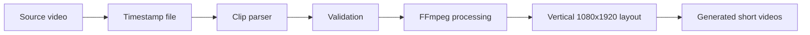
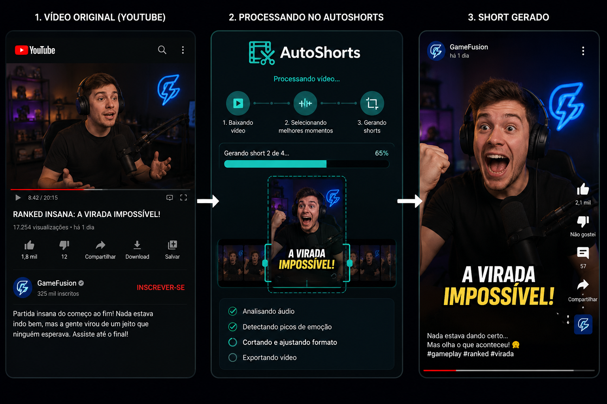

# AutoShorts — Portfolio Edition

O ciclo automático local até `QUEUED` está documentado em
[docs/production-cycle.md](docs/production-cycle.md).

A transcrição local opcional está documentada em
[docs/transcription.md](docs/transcription.md).
A análise real por transcript está documentada em
[docs/gemini-analysis.md](docs/gemini-analysis.md).

Automated local pipeline for transforming selected moments from long-form videos into vertical short-form content.


> This repository contains the portfolio edition of a larger private automation project. It demonstrates the local media-processing pipeline while excluding credentials, authenticated sessions and production-specific integrations.

---

## Linux desktop — start here

The minimal local interface lets you choose a video, open or edit cuts, validate,
render, cancel, and follow overall/per-clip progress without memorizing commands.
The CLI remains available with its existing arguments.

```bash
sudo apt install python3-venv python3-tk ffmpeg xdg-utils
python3 -m venv .venv
.venv/bin/python -m pip install -e ".[dev]"
.venv/bin/autoshorts-install-desktop
.venv/bin/autoshorts-gui
```

Run those commands from the repository on branch `codex/resume-audit`. After
installing the shortcut, open **AutoShorts** from the Linux application menu.
No `.env` is required with FFmpeg/FFprobe on PATH. If you already have `.env`,
check that its executable paths are Linux paths.

See [the Linux GUI guide](docs/local-gui.md) for updating an existing checkout,
the interface comparison, usage, cancellation behavior, and test checklist.

## About the project

AutoShorts receives a source video and a list of selected timestamps, cuts each moment with FFmpeg and exports vertical videos ready for short-form platforms.

The public edition focuses on the core engineering work:

- Parsing clip definitions
- Validating timestamps
- Cutting source videos
- Converting horizontal media to a vertical layout
- Creating a blurred background
- Preserving optional audio
- Loading configuration from environment variables
- Running the complete flow through a command-line interface
- Probing and validating source media before rendering
- Dry-run render plans and machine-readable run manifests
- Atomic outputs with explicit overwrite policies
- Bounded parallel rendering
- FFprobe validation of generated dimensions and duration

Production account integrations, authenticated browser sessions and private automation logic remain outside this repository.

## Pipeline



## Visual demonstration

The image below represents a fictional long-form video used as input by the pipeline.



*Fictional demonstration created exclusively for this portfolio project.*

## Technologies

| Area | Technology |
|---|---|
| Language | Python |
| Media processing | FFmpeg |
| Configuration | python-dotenv |
| Interface | Tkinter/ttk desktop and command-line interface |
| Data formats | Text and JSON |
| Version control | Git and GitHub |

## Project structure

```text
autoshorts/
├── config/
│   └── pipeline.example.json
├── docs/
├── samples/
│   ├── cuts.demo.txt
│   ├── cuts.example.txt
│   └── sample.png
├── src/
│   └── autoshorts/
│       ├── __init__.py
│       ├── config.py
│       ├── media_probe.py
│       ├── main.py
│       ├── naming.py
│       ├── pipeline.py
│       ├── render_plan.py
│       ├── timestamp_parser.py
│       └── video_processor.py
├── tests/                     # Unit and FFmpeg integration tests
├── pyproject.toml
├── .env.example
├── .gitignore
├── requirements.txt
└── README.md
```

## Requirements

- Python 3.11 or newer
- FFmpeg available in the system `PATH`
- Windows PowerShell or a Linux shell

## Installation

Clone the repository:

```powershell
git clone https://github.com/Lpao2/autoshorts.git
cd autoshorts
```

Create a virtual environment:

```powershell
python -m venv .venv
```

Install the project and development dependencies:

```powershell
.\.venv\Scripts\python.exe -m pip install -e ".[dev]"
```

Create the local configuration file:

```powershell
Copy-Item .env.example .env
```

The default settings use FFmpeg from the system `PATH` and write generated videos to `data/output`.

## Clip definition format

Create a text file using one clip per line:

```text
[00:15 - 00:42] - First gameplay highlight
[01:10 - 01:48] - Unexpected comeback
[00:02:05 - 00:02:47] - Final match-winning play
```

Accepted timestamp formats:

```text
MM:SS
HH:MM:SS
```

## Usage

Run the pipeline:

```powershell
.\.venv\Scripts\autoshorts.exe `
  --input "path\to\source-video.mp4" `
  --cuts "samples\cuts.example.txt"
```

Use a custom output folder:

```powershell
.\.venv\Scripts\autoshorts.exe `
  --input "path\to\source-video.mp4" `
  --cuts "samples\cuts.example.txt" `
  --output "path\to\output"
```

Generated files follow this pattern:

```text
01_First_gameplay_highlight.mp4
02_Unexpected_comeback.mp4
03_Final_match-winning_play.mp4
```

## Configuration

The `.env.example` file documents the available local settings:

```env
FFMPEG_PATH=ffmpeg
FFPROBE_PATH=ffprobe
INPUT_DIR=./data/input
OUTPUT_DIR=./data/output
MAX_WORKERS=2
OUTPUT_WIDTH=1080
OUTPUT_HEIGHT=1920
MAX_CLIP_DURATION=60
EXTRA_CLIP_SECONDS=6
VIDEO_CODEC=libx264
VIDEO_PRESET=medium
VIDEO_CRF=20
AUDIO_CODEC=aac
AUDIO_BITRATE=192k
OVERWRITE_POLICY=error
```

The real `.env` file is ignored by Git.

## Privacy and security

This repository does not include:

- Account credentials
- Browser cookies
- Authenticated sessions
- Channel identifiers
- Personal directories
- Production upload integrations
- Generated media files
- Private automation strategies

Sensitive and generated files are excluded through `.gitignore`.

## Status

The public local-processing pipeline is functional.

Current capabilities:

- Timestamp parsing
- Input validation
- Automatic filename sanitization
- Bounded parallel clip processing
- Vertical video generation
- Blurred background composition
- Optional audio preservation
- CLI execution
- External configuration

Possible future improvements:

- Subtitle rendering
- Persistent project library and queue
- Optional content-analysis adapters
- Pluggable uploader interfaces

See [the manual end-to-end test](docs/manual-test.md) to validate the current
pipeline with a real local video.

---

Developed by **[Lucas Patrocínio](https://github.com/Lpao2)**.
