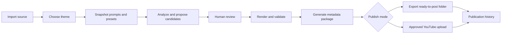

# AutoShorts product vision

## Purpose

AutoShorts is a personal, local-first production library for turning different
types of long-form media into organized short-form publishing packages.

The product is not tied to one niche. A user should be able to maintain several
themes, give each theme different analysis instructions, visual presets, title
rules, and destination channels, then process new source media through the
appropriate workflow.

The initial goal is personal use. The architecture should preserve the option
to become a product later without introducing multi-tenant, billing, or team
complexity now.

## Core concepts

| Concept | Responsibility |
| --- | --- |
| Library | Local catalog of source videos, projects, generated clips, and publication history |
| Theme | A reusable content identity such as gameplay, podcast, education, or commentary |
| Prompt set | Versioned instructions for transcription analysis, candidate selection, titles, descriptions, and tags |
| Render preset | Aspect ratio, framing, background, subtitles, branding, audio, and codec settings |
| Channel profile | Destination-specific metadata rules and a reference to credentials stored outside the project database |
| Project | One source video processed with a selected theme and configuration snapshot |
| Candidate | A proposed clip with timestamps, rationale, score, and review state |
| Render | A generated media file plus technical validation results |
| Publication package | Final video, title, description, tags, thumbnail, target channel, and checklist |
| Publication record | Upload state, platform identifier, timestamps, retries, and audit history |

## Intended workflow



## Theme example

```yaml
name: Educational electronics
analysis:
  prompt_set: electronics-ptbr-v2
  target_duration_seconds: [25, 55]
  candidate_count: 8
render:
  preset: vertical-captioned-clean
metadata:
  language: pt-BR
  title_prompt: concise-educational-title-v1
  description_prompt: electronics-description-v1
destination:
  channel_profile: youtube-electronics
```

The persisted project must store a configuration snapshot rather than only
references. Changing a theme later must not make an old render impossible to
reproduce.

## Personal-first interface

A local web interface is the recommended primary UI because the product needs
library browsing, configuration forms, clip review, previews, queues, and
publication history. The CLI remains valuable for automation and testing, but
should call the same application services as the UI.

Recommended initial surfaces:

1. Dashboard and processing queue.
2. Source and project library.
3. Theme, prompt, and render-preset editor.
4. Candidate review with timestamps and rationale.
5. Render preview and validation results.
6. Ready-to-post packages and publication history.
7. Channel profiles and credential status.

## Publishing policy

The first reliable milestone should create a ready-to-post folder containing:

```text
clip.mp4
thumbnail.png
metadata.json
title.txt
description.txt
upload-checklist.md
```

Direct YouTube upload comes after export packages are stable. Upload must be an
explicit approved action, use the official YouTube API, support multiple channel
profiles, and record idempotency and platform video IDs. OAuth refresh tokens
must live in an OS credential store or restricted secret file, never Git or the
ordinary project database.

## Deliberate non-goals for the first release

- Multi-user accounts and permissions.
- Billing, subscriptions, or commercial licensing.
- Team collaboration.
- Automatic posting without review.
- Every social platform at once.
- A promise of virality or opaque engagement scores.

## Product principles

1. Configuration should be reusable, inspectable, and versioned.
2. Every generated clip should be reproducible from its project snapshot.
3. AI proposes; the user approves.
4. Local processing is the default and cloud transmission is explicit.
5. Publishing must be idempotent and auditable.
6. Themes are configuration, not branches or duplicated code.
