# AutoShorts technical audit

Audit date: 2026-10-16

## Current state

The repository contains a small deterministic pipeline:

```text
timestamp text file -> parser -> FFmpeg command -> vertical MP4 files
```

The parser and FFmpeg command builder are understandable and the Python source
compiles. The project does not currently provide an installable package, test
suite, automated content analysis, subtitles, subject tracking, persistent job
state, real uploader, or a verified end-to-end fixture.

## What is already useful

- Clear separation between timestamp parsing and rendering.
- Safe filename normalization for Windows-hostile characters.
- 9:16 composition with a blurred background and full foreground frame.
- Optional source audio mapping.
- Environment-based local configuration.
- No production credentials or authenticated sessions in Git.

## Confirmed gaps

### Reproducibility

- `requirements.txt` is unpinned and contains only `python-dotenv`.
- There is no `pyproject.toml`, console entry point, lock file, CI, linting, or
  supported-version test matrix.
- The CLI fails in a clean environment until dependencies are installed.
- Several text files contain a UTF-8 BOM.

### Configuration drift

- `MAX_WORKERS` is documented but not represented by `Settings` or used.
- `config/pipeline.example.json` is never loaded.
- `streamer_height_ratio`, `video_codec`, and `audio_codec` are documented in
  JSON but ignored by the renderer.
- Video and audio codecs, CRF, preset, bitrate, and overwrite behavior are
  hard-coded.

### Input validation

- Malformed non-empty lines are silently ignored by the timestamp parser.
- The source is checked for existence, but not probed for duration, streams,
  resolution, frame rate, rotation, or usable audio.
- Clips are not checked against source duration.
- Extending a clip by `extra_clip_seconds` can run past the source boundary.
- FFmpeg and encoder availability are not validated before processing begins.

### Execution safety

- Processing is sequential even though worker configuration is documented.
- `-y` overwrites existing output without an explicit policy.
- Failed renders can leave partial files.
- There is no timeout, cancellation, retry policy, progress reporting, or
  machine-readable result manifest.
- Errors expose only the tail of FFmpeg stderr and lack structured context.

### Product pipeline

- Clip selection remains fully external and timestamp-based.
- No transcription, subtitle rendering, scene analysis, face/object tracking,
  scoring, review step, branding template, thumbnail, or publishing adapter is
  implemented.
- `mock_uploader.py` is empty and no uploader contract exists.

### Quality assurance

- No unit, integration, or end-to-end tests exist.
- No tiny synthetic media fixture is generated for repeatable FFmpeg tests.
- The README lists `tests/` and `docs/`, but the original repository did not
  contain a test suite or technical documentation directory.

## Highest-risk behaviors

1. Silent acceptance of partially malformed cut files.
2. Unconditional output overwrite.
3. No source-duration validation before a batch starts.
4. Configuration that appears supported but is ignored.
5. No automated proof that generated files are valid vertical videos.

## Recommended architecture

```mermaid
flowchart LR
    A[Source adapter] --> B[Probe and normalize]
    B --> C[Transcript / signals]
    C --> D[Clip candidate providers]
    D --> E[Scoring and review]
    E --> F[Render plan]
    F --> G[FFmpeg renderer]
    G --> H[Validation]
    H --> I[Output manifest]
    I --> J[Optional publisher adapters]
```



Each stage should exchange typed domain objects and write enough state to
resume safely. Human-authored timestamps remain a first-class candidate
provider, not a temporary compatibility path.

## Security and privacy baseline

- Local processing by default.
- Explicit disclosure before any transcript, audio, frame, or final video is
  sent to a cloud provider.
- Provider credentials loaded outside Git.
- Upload adapters disabled unless configured explicitly.
- Logs redact paths, tokens, cookies, and account identifiers.
- Generated media and job state remain ignored by Git.
